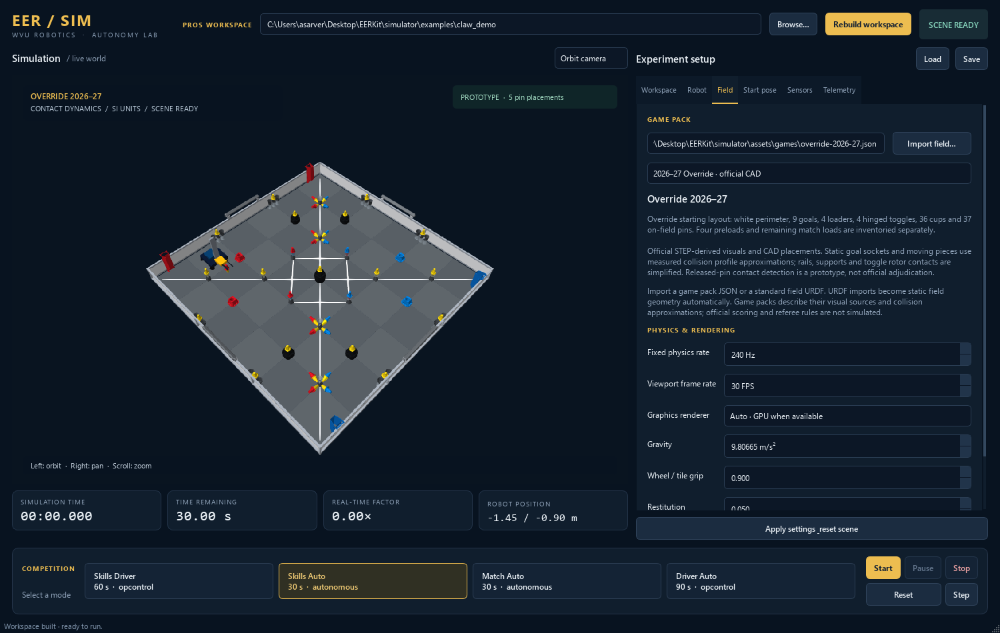

# EER SIM · WVU Autonomy Lab

A standalone desktop hub for running EERKit/PROS robot source against an articulated robot
in a 3D physics field. Choose Bullet CPU or PhysX CUDA/CPU physics in the PySide6
desktop; VTK/OpenGL independently renders the field and robot preview. The same
VEX motor and sensor model connects each physics backend to a native C++ process
running the workspace's existing PROS competition callbacks.



[Watch the 35-second sneak peek](docs/sneak-peek.mp4): field controls, live URDF
motor setup, and a PROS routine physically gripping and placing a pin. The
autonomous segment uses Bullet and plays at one times simulation speed; wall-clock performance
is reported separately in the [validation notes](docs/validation.md).

## Start here

Download **EERSim-Setup-x64.exe** from the private
[0.1.1 Windows preview](https://github.com/WVUR1/EERSim/releases/tag/v0.1.1-windows-preview.1).
It bundles Python, the PhysX GPU runtime, simulator dependencies, default robots
and fields, and the native robot compiler. It installs for your Windows account
without administrator privileges; a desktop shortcut is optional. This private
build is unsigned. CUDA physics requires a supported NVIDIA GPU and driver.
The integrated backend completed the full PROS claw routine on a Linux A100;
Windows packaging, CPU execution, and fallback were checked headlessly. Actual
Windows CUDA execution remains unverified. See [validation](docs/validation.md).

Use **Robot → Import URDF…** and **Field → Import field…** to select custom
designs from your own folders. The robot import preview supports motor setup and
live jogging. Click **Apply settings & reset scene** after importing, and use
**Save/Load** in **Experiment setup** to retain profiles. Keep meshes beside their
URDFs; custom files do not need to be copied into the installation directory.
Updates and uninstall preserve EERSim user data and external projects.
See [Windows installer and EXE builds](docs/windows-release.md) for installation,
build options, and optional certificate signing.

To run from source instead, use the setup below.

On **64-bit Windows**, open PowerShell in the EERSim repository root. If you
already have a clone, run `git pull` first to get the current setup script. Then run:

```powershell
.\setup.ps1
.\launch.ps1
```

Setup downloads its own Python and simulator dependencies into
`.sim-tools/physics-env`. It needs an internet connection and several gigabytes
of free disk space; no existing Python, Conda, or administrator privileges are
required. It ignores global Python installations. Run setup once, then use
`launch.ps1` for normal starts. Rerun setup to update or repair dependencies,
including PySide6. **Setup does not install the desktop C++ compiler** needed to
build robot code; compiler options are below.

GPU physics is an optional source dependency. After setup, install it into the
same environment:

```powershell
& .\.sim-tools\physics-env\python.exe -m pip install -e ".[gpu]"
```

In an activated Conda or virtual environment, use `python -m pip install -e
".[gpu]"`. This pins `ovphysx==0.5.11`, `ovstage==0.1.1.355824`, and
`scipy==1.16.3`. Source installs without these packages use Bullet under the
default **Auto** physics selection. CUDA requires an NVIDIA GPU with compute
capability 7.0 or newer and a driver exposing CUDA 12.8 or newer; the application
checks both. See [physics backends](docs/gpu-physics.md) for device selection and
the current validation limits.

If launch reports `No module named 'PySide6'` or another missing dependency, run
`setup.ps1` again, then inspect the selected Python and dependency checks with:

```powershell
.\launch.ps1 --check
```

The launcher validates dependencies before using a local `.venv` or another
discovered environment. `EERSIM_PYTHON` explicitly overrides the managed
environment. If that variable points at an old environment, remove the override
for the current PowerShell session and launch again:

```powershell
Remove-Item Env:EERSIM_PYTHON -ErrorAction SilentlyContinue
.\launch.ps1
```

For a manually managed environment on Windows, macOS, or Linux, first install
[Miniforge](https://github.com/conda-forge/miniforge) or use an existing Conda
installation. On Windows, run these commands in the Miniforge Prompt:

```sh
conda env create -f environment.yml
conda activate eersim
python -m pip install -e . --no-deps
python -m eersim
```

Use a desktop C++17 compiler: LLVM-MinGW or MSYS2 UCRT64 GCC on Windows,
Xcode command-line tools on macOS, or GCC/Clang on Linux. Add it to `PATH`,
or set `CXX` to the compiler executable's full path. MSVC works from a Developer
Command Prompt. The ARM compiler used by `pros make` cannot create desktop
executables. PyPI's current PyBullet release has no Windows wheels; the conda
environment supplies a prebuilt engine. Linux Python 3.11 can alternatively use
`python -m pip install -e '.[test,gamepad]'` in a virtual environment.
The conda package version is `3.25`; its Python distribution reports `3.2.5`.
That combination is included in the supported dependency range and is the
Windows engine used for the repository's local validation.

See [repository and large-asset guidance](docs/repository.md) for portable setup,
ignored CAD/tool downloads, and Git LFS instructions for future oversized assets.

1. Use **Browse…** in the workspace bar to select your external PROS directory
   containing `src/` and `include/`, then click **Build workspace**.
   EERSim itself is not a robot workspace.
2. In **Robot**, click **Import URDF…**. The setup dialog discovers movable joints;
   assign smart ports, VEX cartridges, and external gearing in the GUI. A matching
   binding sidecar is reused when present, and new assignments are saved in the
   experiment profile. Hold **Jog − / Jog +** to exercise the selected motor in
   the live 3D preview while configuring its port. The built-in X-drive matches the validated EERKit workspace's motor
   ports, reversals, intake, and ADI pistons.
3. In **Field**, choose a preset or use **Import field…** for a JSON pack or field
   URDF. Adjust **Start pose** and **Sensors**, then click **Apply settings & reset scene**.
4. Choose a competition mode and start. Focus the field view to use the keyboard,
   or use the on-screen controls. **Driver station** in the Workspace tab lists key bindings.
5. Pause/resume, advance one physics tick, reset, or export pose telemetry to CSV.
   Save an experiment profile to retain the workspace, asset paths, bindings,
   starting pose, sensor seed, physics backend/device/iterations, timing settings,
   and camera view. CSV export is in **Telemetry**.

An optional USB gamepad uses pygame (`python -m pip install 'eerkit-simulator[gamepad]'`).
The robot receives ordinary `pros::Controller` values, including button edges.
Keyboard input is released when the viewport loses focus.

Both the field view and import preview support left-drag orbit, right/middle-drag
or Shift-left-drag pan, and mouse-wheel zoom. The import preview fixes the robot
base so a wheel test stays in view; joints and their motor loads still simulate.
This setup preview uses Bullet independently of the main field's physics engine.

For an immediately runnable mechanism example, click **Load claw scoring demo** in the
Workspace tab. This loads a separate six-motor X-drive, a lift and claw, one
red/yellow preload, and ordinary PROS source from
[`examples/claw_demo`](examples/claw_demo). It builds the program and selects
Skills Auto; press **Start** to run it. The routine grips the preload, lifts it,
drives to a red alliance goal using the serial odometry interface, and releases
it. The viewport reports prototype pin placements. Driver mode also supports
the claw and lift using R1/R2 and L1/L2.

## Competition modes

| Button | PROS callback | Default duration |
| --- | --- | --- |
| Skills Driver | `opcontrol()` | 60 s |
| Skills Auto | `autonomous()` | 60 s |
| Match Auto | `autonomous()` | 30 s |
| Driver Auto | `opcontrol()` | 90 s |

Defaults target **VEX U**. Durations are editable in **Start pose**; use 15/105
seconds when testing a V5RC match. “Driver Auto” preserves the requested button
name and represents the match driver period; autonomous routines called by your
operator-control code execute normally.

Each new run starts a fresh robot process, calls `initialize()` and
`competition_initialize()`, and then starts the selected callback. Initialization
can move mechanisms using live sensor feedback and does not consume competition
time. At the time limit, outputs are disabled,
the `disabled()` callback is given a scheduler turn, and the robot process is
closed. Reset restores the entire world and random seed. Pausing preserves the
current process and freezes simulated time.

## Source compatibility and external odometry

The simulator copies sources and headers into `.eersim/build/<content-hash>/`
and overlays the PROS hardware headers. It compiles all workspace C++ sources
without modifying the originals. The existing PROS Makefile, firmware, and robot
build stay usable. Compiler errors appear in the GUI log. The build cache tracks
source/header content and the adapter.

Validation against WVU Robotics Club's EERKit workspace compiled and ran its
**11 C++ source files unchanged**. EERKit is a separate, optional checkout; the
simulator also includes the standalone PROS claw example described above.
The implemented API covers the motor/group, task/timing, controller, IMU,
rotation, distance, ADI/pneumatic, LCD, and serial operations described in
[native compatibility](native/README.md). Unsupported devices and calls fail
explicitly. This is source compatibility for implemented APIs, not an ARM
emulator or a complete PROS kernel. ARM-only libraries, arbitrary C extensions,
LVGL brain screens, cameras, radio networking, and unimplemented PROS devices
need additional host adapters. Optional `eersim.build.json` selects sources,
include directories, and preprocessor definitions for complex workspaces.

**No external odometry node is needed.** The simulator supplies the robot pose
through the existing EERKit `pros::Serial` OTOS interface using its `!`-framed
20-byte messages. Position overrides change the odometry reference frame;
they do not teleport the physical robot. The Sensors tab can degrade the reported
pose for testing. Zero noise and latency provide direct simulation coordinates.

| Interface | Coordinates / units |
| --- | --- |
| URDF and physics | SI; +X forward, +Y left, +Z up; yaw counterclockwise |
| Start Pose tab | metres, heading in degrees |
| `World.snapshot().pose` / CSV | metres, counterclockwise yaw in radians |
| PROS motor getters | configured degrees/rotations/counts, velocity RPM |
| Default IMU | clockwise heading/rotation in degrees |
| Default OTOS wire frame | X inches, negative world Y inches, counterclockwise heading degrees |
| EERKit chassis pose | X inches, Y right inches, clockwise heading degrees (EERKit negates the wire heading) |

Sensor coordinate signs and bindings live in the robot JSON so a different
odometry convention can be configured. The headless `World.snapshot()` API also
exposes direct coordinates to Python experiments and other odometry adapters.

## Physics and repeatability

**Field → Physics engine** selects the engine computing motion and contacts:

| Selection | Behavior |
| --- | --- |
| Auto · CUDA when available | Tries PhysX CUDA; uses Bullet if dependencies, the device, or scene initialization are unavailable. The reason is shown in Field, Telemetry, and the log. |
| Bullet · CPU | Uses the existing Bullet solver. |
| PhysX · NVIDIA CUDA | Requires the selected CUDA device and runtime; initialization errors stop the load instead of changing engines. |
| PhysX · CPU | Uses PhysX CPU dynamics and requires the same PhysX runtime packages. |

Click **Apply settings & reset scene** after changing engines. Save an explicit
engine selection when comparing experiments across machines: **Auto** can select
different solvers on different computers. **CUDA physics device** is a logical
ordinal starting at 0 after `CUDA_VISIBLE_DEVICES` filtering, not necessarily the
physical index printed by `nvidia-smi`.

The CLI exposes the same settings independently of graphics:

```sh
python -m eersim --physics-backend physx_gpu --physics-device 0 --solver-iterations 100
python -m eersim --physics-backend bullet --renderer gpu
```

PhysX advances the authoritative robot articulation, field bodies, and contacts
in a separate process. The shared VEX model applies motor and omni-wheel forces,
then supplies encoder, IMU, distance, and OTOS observations to the unchanged PROS
runtime. Rendering consumes those PhysX poses; it does not advance another
physics world. CPU work remains in robot code, control/sensor calculations, and
state exchange. See [backend details and limits](docs/gpu-physics.md).

Graphics default to **Auto**, which probes the OpenGL driver in an isolated
process and enables GPU rendering when a hardware context is available. The
active graphics device is reported in the desktop log and **Telemetry**. Select
**Auto**, **GPU**, or **CPU** with **Field → Graphics renderer**, then apply the
settings. Both the field camera and live motor preview use this path. The verified Windows adapter
is an Intel Iris Xe with OpenGL 4.5; a discrete NVIDIA GPU is not required.
Use `python -m eersim --renderer cpu` to select Bullet's CPU renderer, or
`--renderer gpu` to request OpenGL explicitly. Unsupported graphics drivers or
visual formats fall back to CPU rendering with a reason in the status/log.

The **Physics** and **Graphics** status lines are separate. An OpenGL GPU device
does not imply CUDA physics, and CUDA physics can run with CPU graphics.

The [earlier PhysX/CUDA study](tools/physx_prototype/README.md) remains a separate
passive benchmark with geometry and joint audits. Its A100 timings exclude PROS,
motors, tire forces, sensors, and rendering. They are historical prototype
measurements, not performance results for this integrated backend.

Both engines use a **240 Hz** fixed timestep by default, independent of display FPS.
Rendering never increases the timestep or discards pending physics steps. When
a machine falls behind, the renderer refreshes less often and the simulation
can run slower than wall time. The GUI reports real-time factor and backlog.
PROS delays, timestamps, and competition timers use the same simulation clock.
**Solver iterations · advanced** defaults to 100. It controls Bullet's iteration
limit or PhysX TGS position iterations; PhysX velocity iterations remain 1.
Reducing the count changes solver convergence, and equal counts across engines
do not imply equivalent numerical behavior.

**Earlier Bullet measurements found the full dynamic Override field expensive:** about
0.02× real time on the tested machine. The optional fixed-piece Override preset
measured 0.90× and the practice field 1.20× in headless runs of the existing robot
code. The integrated PhysX CUDA claw run on an A100 completed 30 competition
seconds in about 707 seconds of stepping, **0.043×** at 240 Hz and 100 iterations.
That result verifies operation, but does not establish a CPU speedup or predict
GeForce performance. Choose the fixed-piece layout for route iteration and the
full scene for movable game-piece interactions. See [measurement conditions](docs/validation.md).

There is no Tensor Core toggle. This integration uses PhysX rigid-body contact
and constraint kernels, not a matrix-inference workload with a supported Tensor
Core path. DLPack tensor exchange is a buffer interface; it does not enable
Tensor Cores.

The C++ runtime schedules runnable robot tasks until they yield at PROS calls
before returning motor outputs for the next physics tick. A watchdog reports
code that never yields; it does not let physics silently run ahead. Supported
task behavior is cooperative and does not reproduce V5 RTOS priority/preemption
or desktop wall-clock timing calls such as `std::chrono`.

V5 motor models use cartridge presets, the published torque-speed envelope,
gearing, efficiency, and brake/hold modes. VEX rates the motor at 11 W; its
performance graph reports a peak around 12.75 W. The model keeps that distinction
and approximates the graph rather than treating torque as a simple straight line
from stall to nominal speed. Green/blue torque values below are inferred by
scaling VEX's published red-cartridge stall torque by the cartridge ratios.

| Physical cartridge | Nominal RPM | Stall torque | Encoder ticks/revolution |
| --- | --- | --- | --- |
| Red · 36:1 | 100 | 2.1 N·m | 1800 |
| Green · 18:1 | 200 | 1.05 N·m | 900 |
| Blue · 6:1 | 600 | 0.35 N·m | 300 |

The physical cartridge is selected in the GUI. A different gearset configured
in robot code cannot change physical gearing; a mismatch is reported. The
external reduction acts after the cartridge: a 2:1 reduction doubles ideal joint
torque and halves joint speed. Transmission efficiency applies separately.
PhysX's implicit motor-drive torque feedback is currently a bounded estimate,
not measured solver reaction torque; reported motor current is derived from that
estimate. Do not treat it as validated load-cell or electrical-current telemetry.

X-drive wheels use
a contact-dependent friction model for free omni rollers; the tank sample uses
ordinary wheel contacts. Wheel forces act on rigid bodies and load the motors.
There is no commanded chassis velocity or position teleporting during driving.
All included maps share the same default tile surface. Friction describes a
wheel/material pair and is adjustable for wheel tread, wear, and contamination;
the default is a calibration parameter, not a published universal VEX coefficient.
The Field tab separately exposes **Plastic contact friction** for game pieces
and fixtures. Its default body coefficient is 0.5, while the tile coefficient
is 0.9. Both backends use multiplication of contacting body coefficients, giving 0.25 for two
plastic bodies and 0.45 for plastic on the tile. These are adjustable starting
assumptions; VEX has not supplied measured coefficients for this model.

Noise is sampled once per physics tick from a seeded generator; repeated sensor
reads and camera renders do not resample it. Position, heading, encoders, and
distance have separate noise amplitudes. Latency delays observations, and dropout
holds the last delivered sensor frame. Ground truth in the viewport/CSV remains
separate from the observations supplied to robot code.

**Accuracy requires calibration.** The bundled robot has illustrative geometry,
mass, inertia, friction, motor curves, and mechanisms; it is not a measured model
of the team's competition robot. Battery sag, temperature, drivetrain compliance,
vision, and full game scoring are not implemented. Use measured robot URDF
properties and compare straight-line acceleration, stopping distance, rotation,
and mechanism loads against hardware before trusting quantitative predictions.
Repeatability depends on the engine, solver settings, platform, and input stream.
Matching seeds do not guarantee identical Bullet/PhysX trajectories or
cross-platform bitwise determinism.

## Robots and programmable joints

Standard URDF remains the robot design format; no VEX-specific XML dialect is
required. **Import URDF…** discovers joints and opens hardware setup. Choose
ports, cartridge colors, external reductions, and linear-joint lead there, then
hold **Jog − / Jog +** to check movement. **Preview robot & test motors** reopens
the preview with your current assignments. The motor table supports several
motors on one joint. Save an experiment to retain the configuration without
editing JSON. The built-in robot presets are ready to use.

URDF files must have valid inertial and collision properties. Use simple collision
meshes and primitives even when visual meshes are detailed. Asset paths resolve
relative to their files. The importer resolves ROS `package://` references from
nearby package folders and reports missing or ambiguous assets. Resolved imports
are cached under `.eersim/imports` for source use or the user's EERSim application
data directory in the installed application; the original design files remain untouched.
The binding editor maps unique smart ports to URDF joint names and cartridge RPM.
Multiple motors may drive one joint, with their torque contributions summed.

```json
{
  "schema_version": 1,
  "name": "My robot",
  "motors": [
    {"port": -1, "joint": "left_wheel", "rpm": 600, "gear_ratio": 1},
    {"port": 2, "joint": "right_wheel", "rpm": 600, "gear_ratio": 1}
  ]
}
```

A negative binding port describes the physical shaft reversal; the C++ motor
object's reversal applies separately. Match both to your wiring and geometry,
as the sample does. `gear_ratio` is motor rotations per joint rotation. Prismatic
actuators additionally use `lead_m` in metres per revolution. See the complete
[X-drive configuration](assets/robots/xdrive.json) for omni-wheel directions,
sensor placement, and pneumatic bindings.

In Python, `World.step()` accepts motor, pneumatic, and direct joint commands:

```python
from eersim.config import default_config
from eersim.physics_backend import create_world

def main():
    config = default_config()
    config["physics_backend"] = "physx_gpu"  # or "bullet" / "physx_cpu" / "auto"
    with create_world(config) as world:
        for _ in range(240):
            observation = world.step({
                "joints": {"intake": {"mode": "velocity", "value": 8.0, "force": 0.3}},
                "adi": {"B": True},
            })

if __name__ == "__main__":
    main()
```

Use the main guard when creating a PhysX world from a Python script, because it
spawns an isolated worker. Direct `eersim.physics.World` construction always uses
Bullet; `create_world` applies the configured backend selection.

Joint position/velocity use radians and rad/s for rotary joints, metres and m/s
for sliders. Torque control uses N·m or N. Direct joint commands are useful for
mechanism experiments; stop robot code before using manual joint controls in
the GUI.

## Updating game maps

Field packs are versioned JSON plus optional URDF/mesh assets. The Field tab
offers built-in presets and a single import action for JSON packs or complete
field URDFs. An imported field URDF is wrapped in a local pack; its authored
floor and walls are used without adding another floor. The Field tab can
load packs from any directory and display their description and accuracy notes.

**Override 2026–27 is the default field**, with the white portable perimeter,
nine goals, four loaders, four hinged toggles, 36 cups, and 37 pins in the starting
layout. Preloads and match loads are recorded separately; the claw experiment
adds one preload. A simpler calibration practice field is also included.

For faster route iteration, select **Override route planning · fixed game pieces**
in **Field**, then apply the settings. It uses the official layout with all 36
cups and 37 field pins treated as immovable obstacles. Robot dynamics and hinged
toggles still simulate. This is a deliberate experiment setting: use the full
Override preset when testing pushing, grasping, and other game-piece interactions.

The official VEX field CAD supplies the element visuals and measured dimensions.
[`assets/cad_manifest.json`](assets/cad_manifest.json) records the source archive,
checksums, named CAD parts, units, conversion tolerances, and assembly transforms.
Detailed meshes are used for appearance; simplified contact geometry preserves
hollow game pieces and goal sockets. Collision approximations, masses and
friction remain calibration parameters. See the [asset notes](assets/README.md)
for the geometry and conversion details.

The placed-pin indicator checks physical insertion and contact after release
from the robot. It includes pins already placed in the starting layout. It is
prototype feedback for mechanism experiments; official point totals, cup stacks,
toggle ownership, match loading and rule violations are not
automatically adjudicated.

Create a new pack or copy an existing one and replace the objects with measured
or official CAD geometry. All object locations and dimensions use metres; object
`rotation` is an XYZ Euler vector in radians. `mass: 0` creates a static object;
positive mass makes it dynamic. Supported shapes are box, sphere, cylinder,
capsule, and a local `urdf`. URDF props can contain articulated mechanisms.

```json
{
  "schema_version": 1,
  "name": "My season field",
  "season": "2026-2027",
  "geometry_accuracy": "Measured practice obstacle",
  "field": {"size": [3.6576, 3.6576], "wall_height": 0.3, "tile_size": 0.6096},
  "objects": [
    {"name": "barrier", "shape": "box", "size": [0.1, 0.8, 0.2],
     "position": [0.5, 0, 0.1], "mass": 0, "color": [0.2, 0.4, 0.8, 1]},
    {"name": "piece", "shape": "sphere", "radius": 0.04,
     "position": [0, 0, 0.05], "mass": 0.1, "color": [0.8, 0.1, 0.1, 1]}
  ]
}
```

Save and apply the pack to rebuild the scene. There is no network dependency for
loading maps and no automatic downloads or executing scripts in field packs.

## Batch experiments and validation

```sh
# Physics only, without a GUI or compiler
python -m eersim --headless --seconds 2 --csv settle.csv

# Set this to your own PROS workspace directory
robot_workspace="/path/to/your/pros-workspace"
python -m eersim --headless --workspace "$robot_workspace" --mode skills_auto --seconds 5 --csv auto.csv

# Bundled PROS claw experiment on the current field
python -m eersim --headless --demo claw --seconds 30 --csv claw.csv

# Explicit CUDA physics; stop with an error if it cannot initialize
python -m eersim --headless --demo claw --physics-backend physx_gpu \
  --physics-device 0 --solver-iterations 100 --seconds 30 --csv claw-cuda.csv

# Saved noise/start-pose experiment, optional fixed driver input JSON
python -m eersim --headless --workspace "$robot_workspace" --config experiment.json \
  --mode skills_driver --seconds 10 --controller controller.json --csv driver.csv

python -m pytest tests -q
```

Replace the `robot_workspace` placeholder with your chosen PROS workspace path.
The bundled claw demo does not require an EERKit checkout. Set
`EERSIM_EERKIT_WORKSPACE` to an EERKit workspace when you also want to run the
optional integration checks against that external code.

`controller.json` uses `{"analog":{"left_y":80,"left_x":0,"right_x":0},"digital":{"r1":true}}`.
CSV records simulation time, competition time, mode, ground-truth XYZ/yaw,
observed OTOS/IMU values, and sensor age so delayed/noisy observations can be
compared with physical motion. OTOS columns contain the world's sensor frame
before any reference offset applied inside robot code.
Interactive recording is capped at 500,000 samples with a visible warning.

Tests exercise render-rate independence, retained backlog, native task lifecycle,
motor reversals, EERKit odometry, collisions, airborne traction, programmable
joints, sensor noise/latency/dropout, and compiling/driving an external EERKit workspace.
Compiler-dependent tests skip if no host compiler is available.
The [local validation notes](docs/validation.md) record the tested environment,
GPU measurements, installed-package checks, and their limits.

## References

- [PyBullet guide](https://github.com/bulletphysics/bullet3/blob/master/docs/pybullet_quickstart_guide/PyBulletQuickstartGuide.md.html): rigid-body API, URDF, explicit stepping, CPU rendering.
- [Qt for Python](https://doc.qt.io/qtforpython-6/): desktop widgets and cross-thread signals.
- [VTK OpenGL render window](https://vtk.org/doc/nightly/html/classvtkOpenGLRenderWindow.html): GPU graphics and driver capability reporting.
- [Pinned PhysX runtime](https://github.com/NVIDIA-Omniverse/PhysX/tree/ovphysx-0.5.11/ovphysx) and [tensor bindings](https://github.com/NVIDIA-Omniverse/PhysX/blob/ovphysx-0.5.11/ovphysx/docs/tutorials/tensor_bindings.md): CUDA/CPU dynamics and state exchange.
- [PROS motor API](https://pros.cs.purdue.edu/v5/pros-4/motors.html): host API behavior, validated against EERKit's vendored PROS headers.
- [VEX V5 motor performance](https://kb.vex.com/hc/en-us/articles/360044325872-Understanding-V5-Smart-Motor-11W-Performance): cartridge torque, speed, and power references.
- [Official Override manual PDF](https://link.vex.com/docs/26-27/v5rc/game-manual), [2026–27 manual versions](https://www.vexrobotics.com/26-27-manuals), and [official field CAD](https://link.vex.com/docs/26-27/v5rc/field-cad): field-pack provenance. Consult the current manual for rules; the simulator does not adjudicate official scores or legality.
