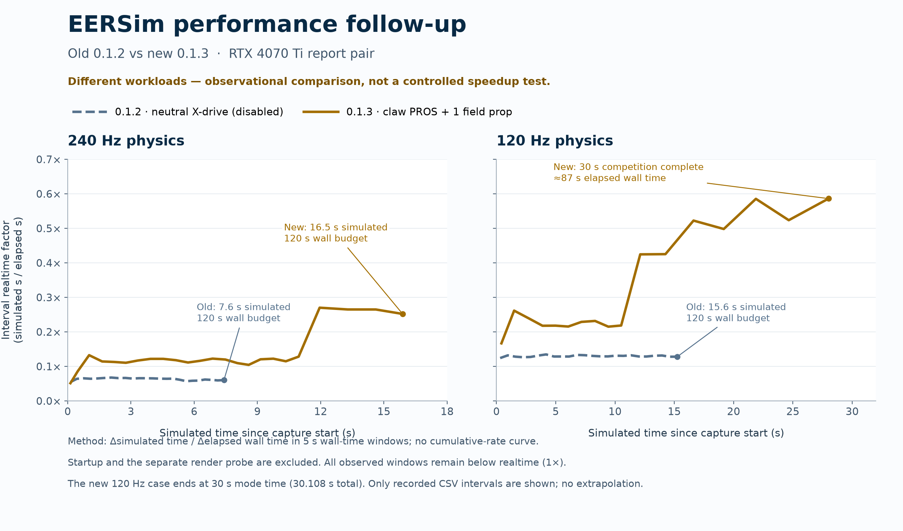

# RTX 4070 Ti follow-up: EERSim 0.1.3

The new capture verifies the zero-wrench correction on Windows GPU physics and
records the native PROS claw demo placing its preload pin. Native stepping costs
less than in the earlier capture, although the simulation still runs below real
time. This is **not a controlled measurement of the fix's speedup**: the earlier
capture used the default X-drive without PROS code, while this one uses the claw
robot, a selected PROS workspace, and an additional preload pin.

The [sanitized metrics](diagnostics-4070ti-followup.json) record the inputs,
formulas, stage timings, contact counters, and GPU telemetry phases. The new ZIP
is 50,771 bytes; all 15 members pass CRC checks. SHA256:
`10c913880a18e94928da8676a1b258aad1692dcc868a27036704cbd4acacbb01`.
Both archives were read as data in memory; no archive contents were executed.

## Comparable settings and changed workload

The Ryzen 9 5900XT, RTX 4070 Ti, NVIDIA driver 616.56, Python 3.11.16, and physics
packages match the baseline. EERSim changed from 0.1.2 to 0.1.3. The start pose,
field-pack hash, gravity, friction, restitution, noise, seed, and 100 TGS position
iterations are unchanged. Both rates verify GPU dynamics, GPU broadphase, and
a valid CUDA context (`scene_gpu_flags=11`), with standard host readback enabled.

The new robot has 10 articulation links and six DOFs, compared with 11 links and
eight DOFs before. The added pin and robot change produce 4,514 collision shapes
instead of 4,459. The selected skills-auto duration is now 30 seconds rather than
60. Requested GUI render FPS changed from 30 to 60; diagnostics step headlessly
and render only a separate stationary probe afterward.

| Measurement | Previous 240 Hz | New 240 Hz | Previous 120 Hz | New 120 Hz |
|---|---:|---:|---:|---:|
| Physics stepping realtime factor | 0.0634x | 0.1387x | 0.1304x | 0.3476x |
| Mean complete tick | 65.761 ms | 30.042 ms | 63.882 ms | 23.972 ms |
| Native PhysX step | 60.485 ms | 25.133 ms | 58.575 ms | 19.159 ms |
| Native step share | 91.98% | 83.66% | 91.69% | 79.92% |
| Contact read/conversion | 1.685 ms | 1.435 ms | 1.620 ms | 1.224 ms |
| State reads | 0.140 ms | 0.115 ms | 0.142 ms | 0.108 ms |
| Control writes | 0.187 ms | 0.241 ms | 0.185 ms | 0.213 ms |
| Other tick work | 3.264 ms | 3.118 ms | 3.360 ms | 3.268 ms |
| Mean raw contact reports | 11,353 | 399 | 11,338 | 251 |

The interval-RTF plot uses five-second elapsed-wall-time bins, plotted at each
bin's simulated-time midpoint. A final fragment shorter than 2.5 seconds is
merged into the preceding bin; otherwise the final partial bin is retained.
The final bin can therefore differ from five seconds. The plot shows differing
workload and settling histories, not a controlled measurement of the correction's
speedup.

The new 240 Hz case advances 16.542 simulated seconds in 120 wall seconds and
stops at its wall budget. The new 120 Hz case advances 30.108 simulated seconds
in 87.104 wall seconds, including initialization, and completes all 30 seconds
of competition time. Different elapsed simulation time and settling phases
also limit comparisons. Stage totals cover the entire run; the SDK-step p50/p95
statistics cover only the most recent 2,048 ticks.

The new runs get faster as they progress: during their last 20 wall seconds,
interval RTF is approximately 0.263x at 240 Hz and 0.560x at 120 Hz, compared
with whole-loop averages of 0.138x and 0.346x. Both show a pronounced transition
near 11–12 simulated seconds. The plot's five-second windows calculate
**change in simulated time / change in wall time**; they are neither cumulative
averages nor instantaneous readings. Earlier scene loading is excluded from
these stepping windows and the loop averages. The different observation windows
help explain a GUI reading around 0.2x versus a diagnostic average around 0.35x;
the capture does not attribute that difference solely to GPU utilization.

## The correction and the claw run are observable

At both rates, counters show exactly 74 zero regular-body wrench rows skipped
and four nonzero rows submitted per tick. Final raw contact reports fall to 12;
68 and 71 contact-presence pairs are retained at 240 and 120 Hz, respectively.
These are presence records for unchanged body transforms, not reused forces
or an exact count of sleeping objects. The reduced contact workload is consistent
with allowing settled field objects to sleep.

Both runs execute all four logged claw stages and increase placed pins from five
to six. The new placement is `demo_preload` in `goal_red_5`. The 120 Hz run also
logs normal mode expiry and disabling after 3,600 native competition ticks.
This is actual Windows GPU PROS claw-placement evidence under the simulator's
prototype contact-based scoring; it does not establish full official game-rule
conformance or accuracy across arbitrary robots and stacks.

## GPU utilization and remaining cost

Filtering samples to the physics phase gives mean GPU utilization of 47.48% and
44.74%, and mean power of 67.15 W and 65.99 W at 240 and 120 Hz. The GPU is mostly
in P2 at 2,805 MHz; maximum temperatures are 56 C and 55 C. Both samplers complete
without errors. The user confirms that no other EERSim simulation was running.

The reported 80–100% utilization during interactive GUI use is a separate
observation. These diagnostic phases exclude continuous rendering; their later
12-frame stationary probes average 8.15 ms and 8.86 ms after the first frame.
Those timings are not interactive GUI FPS. Device-wide utilization also does
not measure kernel occupancy or isolate work inside the synchronous native step.
Native stepping still accounts for roughly 80–84% of complete tick time; this
capture cannot divide that span into CPU collision work, GPU solving, and waiting.

## Next controlled experiment

Keep this exact claw workspace, start pose, preload, field, device, friction,
gravity, and noise. In **Field → Solver iterations · advanced**,
compare **32 against the existing 100-iteration reference** at both 240 and
120 Hz, resetting the scene before each run. Compare successful grasp, lift,
release, placement, stacking stability, drift, and contact penetration over
matched simulated intervals before considering any lower default. A wall-time
cap alone can compare different portions of the autonomous routine.

NVIDIA recommends tuning the iteration count to the smallest value that still
meets the required fidelity; it does not certify a particular count for this
robot or field. [Official ovphysx performance guide](https://nvidia-omniverse.github.io/PhysX/ovphysx/latest/guides/performance.html#solver-iterations).
No solver/default change or new performance claim follows from this capture
alone, and no new binary is required for this analysis.
