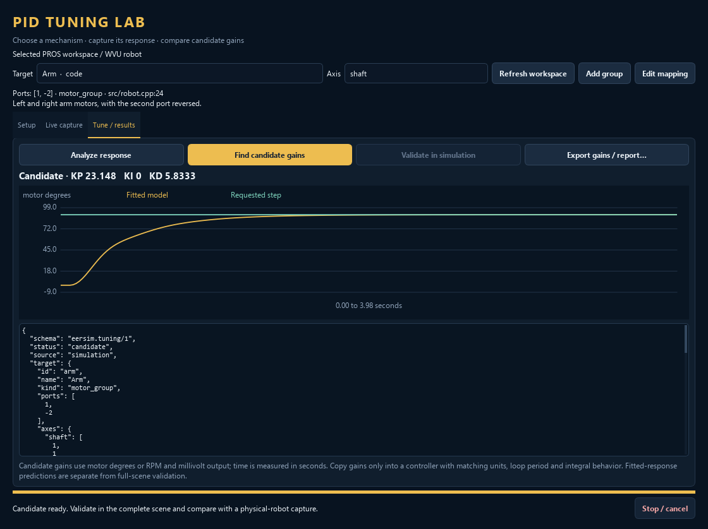

# PID tuning lab

Click **PID tuning…** beside **Build workspace** to open the separate tuning
window. It uses the selected PROS workspace and the robot's motor bindings.
Discovery, recording, response fitting, and candidate search do not rebuild the
workspace. Simulation recording uses the existing PROS bridge; your source needs
no logging calls.

The **How to use** tab contains an offline walkthrough with four topics:
simulation, physical hardware, settings explained, and troubleshooting/gain
units. It includes concrete parameter-adjustment examples and links back to
Setup, Live capture, and Tune / results. It is included in the installer.

The screenshot uses illustrative response data, not a physical-robot capture.
See the [0.1.8 validation record](pid-tuning-0.1.8.md) for tested scope.

## Select a mechanism

Choose a **Target** and **Axis**, then check the displayed ports and source.
**Refresh workspace** rescans changed source. **Add group** and **Edit mapping**
let you configure a single motor, shared motor group, tank drivetrain, H-drive,
or X-drive. Manual mappings are remembered for that workspace on this computer.

| Topology | Motor assignments | Available axes |
| --- | --- | --- |
| Single motor / shared group | Motors moving in the same logical direction | shaft |
| Tank | left, right | forward, turn |
| H-drive | left, right, lateral | forward, turn, strafe |
| X-drive | front-left, front-right, back-left, back-right | forward, turn, strafe |

Enter the signed ports in each side or corner's field; every drivetrain field
accepts multiple motors. For example, an H-drive can use left `1, 2`, right
`-3, -4`, and lateral `5`. The dialog generates forward, turn, and strafe
coefficients automatically. Negative ports reverse the motor's logical
direction. A physical port cannot appear twice in one target; it may belong to
several selectable targets.

For a custom mixture, enable **Advanced: edit axis coefficients directly**.
This optional JSON editor has one coefficient per listed port: `1` follows an
axis, `-1` opposes it, and `0` excludes that motor from that axis. The ordinary
side/corner assignments do not require editing JSON.

Discovery recognizes PROS `Motor` and `MotorGroup` constructors, literal ports,
integer constant aliases and object-like `#define`s, literal port vectors, and
EERKit `TankDrive` / `XDrivetrain` group references. It preserves signed ports,
supported constructor reversal flags, namespaces, and source locations. Explicit
`eerkit::HDrive` / `HDrivetrain` declarations use a conventional left/right/lateral
order and are labelled for verification.

This is a source scan, not C++ execution. Factories, arbitrary wrappers, computed
ports, runtime changes, and conditional build configurations cannot be inferred
reliably. Unresolved definitions appear in the Setup notes. A source-resolved
target confirms the declaration's syntax, not the connected robot. Simulation
binding fallbacks and manual mappings are labelled separately.

The supplied claw demo declares individual motors and a `drive()` mixer rather
than a C++ XDrivetrain object. The tuner also offers **X-drive from robot mapping**
from its imported wheel geometry and port bindings, with forward, turn, and
strafe axes. This target is labelled as a robot mapping for verification; it
does not imply that the source contains a drivetrain class. Use the complete
drivetrain for a test on the floor: driving only one wheel can scrub against the
other grounded wheels and produce a poor single-motor fit.

## Capture, tune, and validate in simulation

1. Import the robot and map the selected motor ports to its joints in the main
   window, then **Apply settings**. Use **Reset simulation** in the tuning window
   when you need to return to the applied starting scene.
2. In **Setup**, choose position or velocity control, controller period, voltage
   limit, characterization pulse interval, travel limit, validation interval, and validation step. Set the integral
   activation error and integral limit to match the controller you intend to use.
3. For the demo X-drive, **Short drivetrain pulse** sets 2000 mV for 0.2 s while preserving the travel bound and the separate validation interval (2 s by default). This starting trial was verified in CPU PhysX at 120 Hz with a 180-degree bound. Check the mechanism and free space for your scene. Click **Characterize in simulation**. This stops the robot program and manual
   joint commands, then drives the selected axis through mapped motor ports with
   a bounded voltage pulse. The capture includes a stopped baseline and coast
   interval. The test ends if a selected motor reaches its travel limit.
4. In **Tune / results**, use **Analyze response** to inspect the recording, then
   **Find candidate gains**. The search fits a delayed first-order velocity model
   and compares controllers across variations in model gain and response time.
5. Reset to the intended starting condition, then click **Validate in simulation**
   to exercise the candidate on the complete robot and field. This also stops
   robot code and owns the selected motor commands during the test. Compare the
   recorded response with the fitted-model prediction; they are different tests.
6. Use **Export gains / report…** to save the candidate, controller settings,
   model, metrics, and prediction as JSON.

To inspect existing robot code instead of running a generated pulse, first
build changed source explicitly with **Build workspace** and wait for it to
finish. Then choose **Live capture → Record live simulation** and start the
normal competition callbacks in the main window. Building after arming
capture stops that recording. **Stop / cancel** ends capture; during a tuning
experiment it also disables the simulated motors. A new trial needs a new
capture after Reset.

Identification needs a continuous recording containing a stationary baseline,
changing voltage, measurable motion, and coast-down. Simulation VEX velocity and
position commands do not expose actual electrical voltage, so those captures can
be inspected but cannot supply this voltage-response fit. Use voltage-driven code
or **Characterize in simulation**. Do not fit through an encoder tare, collision,
hard stop, wheel slip, or changing payload and expect one motor model to explain
the result.

## Record a physical robot

The hardware workflow adds passive telemetry to a separate copy of a standard
PROS 4 project with a global `initialize()` callback. Your original workspace is
unchanged. It requires a working PROS CLI and ARM toolchain; EERSim's desktop
robot compiler alone cannot build V5 firmware. An already-flashed binary cannot
acquire this logger without building and uploading the instrumented copy.
The CLI is discovered through `PATH`; use the optional executable **Browse…**
field when it is installed elsewhere. Hardware recording supports a minimum
20 ms sample period.

1. In **Live capture**, click **1 · Prepare logger copy…** to create a new logger
   workspace outside the original project. Preparation copies the project and
   adds logging for the selected physical ports; it does not overwrite an
   existing destination.
2. Click **2 · Build**. This explicitly builds the logger copy with PROS.
3. Select the V5 program slot and, if necessary, the serial port. Click
   **3 · Upload** to replace that slot with the instrumented program.
4. Click **4 · Connect / record**, start the uploaded program using the robot's
   normal controls, and perform the movement with its existing callbacks.
   Return the robot to its starting condition between trials.
5. Click **Stop / cancel**, inspect the capture, and use the same analysis and
   candidate-search controls as above.

The logger does not start a robot program or command motor motion. Stopping the
terminal recording does not stop the physical robot: its program and normal
controls remain responsible for motion. The utility does not automatically
replace PID constants or run candidate controllers on hardware. Physical V5
logging has not yet been tested on a connected robot.

Logging begins after the original `initialize()` returns. Hardware sampling is
20–1000 ms and reads motors sequentially; serial and CPU overhead can reduce the
achieved rate. Motor telemetry is converted to degrees without changing encoder
units or taring the robot. Unsupported callback layouts or legacy reversal APIs
are reported during preparation instead of rewriting them speculatively.

## Units and reusable captures

These gains are for an outer PID with **millivolt output**, error measured in
**projected motor degrees** or **projected motor RPM**, and time in **seconds**.
Drivetrain axes combine motor encoders; they are not odometry distance or IMU
heading. Do not copy the numbers directly into an inches/metres path controller,
a `move(-127…127)` controller, or VEX's onboard velocity/position controller.

The result now displays gain units and the error at which its proportional
term alone reaches the output cap. For example, `Kp = 202 mV/degree` requests
2020 mV at 10 degrees of error; at a 3000 mV cap it saturates above about
14.9 degrees. In volts that same gain is `0.202 V/degree`. A P-only candidate
can be appropriate for a damped motor-position response, so zero Ki/Kd is not
itself an error. Check model quality, saturation, settling and the actual
validation trace before deciding whether a candidate is useful.

The controller follows EERKit's derivative-of-error behavior. It accumulates
`error × dt` only while the nonzero absolute error is below the activation
threshold, otherwise resetting the integral. The configured integral limit
clamps the integral sum used in the output before multiplication by Ki, without
clamping the stored accumulator. Output is capped at the selected millivolt limit. Preserve these
settings and the actual controller period when transferring gains; simulation
periods are aligned to fixed physics ticks.

**Export capture…** saves JSON Lines (`.jsonl`) or CSV. **Import capture…** reads
the same formats so another computer can fit and compare a recorded trial.
CSV uses `time,source,capture_id,port,position_deg,velocity_rpm,voltage_mv`, with one
row per physical motor at each timestamp. Time is seconds; port identifiers in
the capture are positive physical ports, with reversal applied by the selected
target. Keep each file to one continuous trial and one capture source.

An accepted model and its simulated response provide candidate gains, not
hardware validation. Spec-sheet motor curves do not identify a particular
mechanism's friction, backlash, compliance, battery behavior, or load. Compare
physical recordings and repeat representative loads and directions before
relying on a candidate for the actual robot.

## Recover from a failed trial

Error dialogs include the failed measurements and concrete next steps. The
**How to use → Troubleshooting and gain units** topic explains them in detail.

- **Too short / travel limit:** fast drivetrain motors can consume a 180-degree
  bound before enough data is collected. Shorten the powered interval (for
  example 2 s to 0.5 s), reduce voltage (3000 to 1500 mV), or increase the bound
  only after checking the mechanism's usable travel and clear field space.
  These are adjustment examples, not calibrated presets. Keep room for coast.
- **Poor fit:** check the full drivetrain's signed mapping, choose a clear start
  pose, and keep the load consistent. A collision, hard stop or one-wheel scrub
  can invalidate a simple motor model. Do not try to fix capture quality by
  entering a larger PID gain.
- **Encoder discontinuity:** inspect the reported timestamp, position change,
  velocity-predicted change and per-port differences. Tare/reset during capture,
  latency or sharp contact impulses can create inconsistent data. Export the
  failed capture, reset before a new trial, and report a repeatable simulator
  failure with its backend, physics rate and motor mapping.
- **Missing voltage:** the claw demo uses velocity commands. Use Characterize
  for fitting in simulation; passive recording of those commands still lets
  you inspect movement but does not provide electrical voltage telemetry.

Changing tuning settings invalidates the candidate. Reset alone preserves it,
so reset before **Validate in simulation** to compare the full-scene response
against the candidate's fitted-model prediction. A travel-limit stop now
opens a warning and marks the exported candidate validation as truncated.
Completing a trial is distinct from assessing its controller quality.

The [0.1.10 verification](pid-tuning-0.1.10.md) records successful encoder
correction and characterization, but both the tested 90-degree and 30-degree
full-scene candidates hit an individual-wheel travel guard. A group-average
response can hide unequal wheel motion; those gains are not validated
settings for the demo drivetrain.
